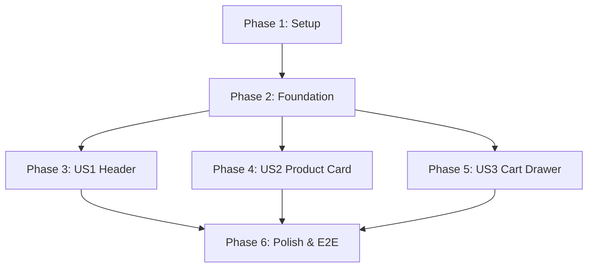

# Tasks: Aristino Frontend Rebuild

**Input**: Design documents from `specs/001-aristino-frontend-spec/`

**Prerequisites**: [plan.md](./plan.md) (required), [spec.md](./spec.md) (required for user stories), [research.md](./research.md), [data-model.md](./data-model.md), [contracts/cart-cookie.json](./contracts/cart-cookie.json)

**Tests**: Included as requested in the specification (optional but recommended for verifying component rendering and logic).

**Organization**: Tasks are grouped by user story to enable independent implementation, testing, and MVP verification.

---

## Phase 1: Setup (Shared Infrastructure)

**Purpose**: Setup workspace structure and packages

- [x] T001 Setup Next.js workspace structure under `frontend/`
- [x] T002 Install standard dependencies in `frontend/package.json` (`js-cookie` for cookie handling, `@tailwindcss/line-clamp`, and testing libraries)
- [x] T003 [P] Configure custom colors (`brand-navy`, `brand-gold`) and serif/sans-serif fonts in `frontend/tailwind.config.js`

---

## Phase 2: Foundational (Blocking Prerequisites)

**Purpose**: Core layouts and middleware required before user story components are designed

- [x] T004 Implement App Router base layout in `frontend/src/app/[locale]/layout.tsx` (includes Google Fonts loader and HTML head wrapper)
- [x] T005 [P] Setup localization middleware in `frontend/src/middleware.ts` to natively support English root subpaths
- [x] T006 Configure Jest testing configuration in `frontend/jest.config.js`

---

## Phase 3: User Story 1 - Header Navigation and Brand Identity (Priority: P1)

**Goal**: Implement the localized Header component in Next.js + Tailwind CSS with responsive layout.

**Independent Test Criteria**: Header renders 7 uppercase navigation links in premium English. Resizing viewport to mobile displays hamburger toggle; clicking it slides in a menu drawer from the left.

### Implementation Tasks
- [x] T007 [P] [US1] Create the nav link array and standard icons in `frontend/src/components/Header.tsx`
- [x] T008 [US1] Implement sticky header styling with backdrop blurring on scroll in `frontend/src/components/Header.tsx`
- [x] T009 [US1] Implement slide-in sidebar navigation drawer from the left edge for mobile viewports in `frontend/src/components/Header.tsx` (animates sliding from the left and displays a dark overlay on the right)
- [x] T010 [US1] Add unit tests validating Header component rendering and navigation clicks in `frontend/tests/components/Header.test.tsx`

---

## Phase 4: User Story 2 - Premium Product Card and Quick Actions (Priority: P1)

**Goal**: Implement the Premium Product Card component.

**Independent Test Criteria**: Hovering over image triggers scale zoom effect. Title clamps at exactly 2 lines max. Swatches show visual feedback on hover.

### Implementation Tasks
- [x] T011 [P] [US2] Implement ProductCardProps interface matching entity definition in `frontend/src/components/ProductCard.tsx`
- [x] T012 [US2] Design product card layout (including hover zoom effect and quick add overlay button) in `frontend/src/components/ProductCard.tsx`
- [x] T013 [US2] Apply CSS line-clamp limits for titles and hover borders on color swatches in `frontend/src/components/ProductCard.tsx`
- [x] T014 [US2] Add unit tests checking product card line clamping and hover zoom interactions in `frontend/tests/components/ProductCard.test.tsx`

---

## Phase 5: User Story 3 - Shopping Bag Drawer Interaction (Priority: P2)

**Goal**: Implement the slide-over Shopping Bag Drawer.

**Independent Test Criteria**: Clicking bag icon triggers slide-over drawer from the right. Cart details show empty/populated states, subtotal, and checkout CTAs in English. State persists on page refresh via cookies.

### Implementation Tasks
- [x] T015 [P] [US3] Implement CartItem interface and CartDrawerProps in `frontend/src/components/CartDrawer.tsx`
- [x] T016 [US3] Implement CartDrawer slide-in overlay container in `frontend/src/components/CartDrawer.tsx` (animates sliding from the right edge with a dark backdrop blocking document click behind it)
- [x] T017 [US3] Add empty cart state representation and Checkout CTA button in `frontend/src/components/CartDrawer.tsx`
- [x] T018 [US3] Implement Cookie state persistence logic helper inside `frontend/src/services/cartService.ts` (using `js-cookie` to store and load cart cookie payload matching JSON schema contract)
- [x] T019 [US3] Add unit tests checking Cookie storage actions and drawer slide toggles in `frontend/tests/components/CartDrawer.test.tsx`

---

## Phase 6: Polish & Cross-Cutting Concerns

**Goal**: Fine-tune global styles, SEO metadata integration, and run validation scenarios.

- [x] T020 Configure global font-family rules in `frontend/src/app/globals.css`
- [x] T021 [P] Validate SEO metadata tags generation on mock product detail page in `frontend/src/app/[locale]/product/[slug]/page.tsx`
- [x] T022 Run the quickstart verification scenarios end-to-end to ensure structural layout and design fidelity

---

## Phase 7: Product Data Schema & Database Customization

**Goal**: Update MongoDB database target to `shirts_collection` -> `products` collection and adapt Product model, API endpoints, and frontend components to support custom product data structure (`id`, `title`, `price` string/number, `description`, `images` array, `color`, `uploadedAt`, `brand`, `status`, `done`, `theme`).

- [x] T023 Update MongoDB URI and Mongoose connection to target `shirts_collection` database in `backend/.env` and `backend/src/config/db.js`
- [x] T024 Update Product model schema in `backend/src/models/Product.js` to support `id`, `title`, `price`, `description`, `images`, `color`, `uploadedAt`, `brand`, `status`, `done`, `theme`, and set explicit collection `'products'`
- [x] T025 Update `getProducts` and `getProductBySlug` controllers in `backend/src/controllers/productController.js` to search/filter by theme, brand, description, and handle string/number prices
- [x] T026 Create product seed script `backend/src/seedProducts.js` and populate database `shirts_collection` under `products` collection with sample product data
- [x] T027 Update frontend TypeScript interface in `frontend/src/types/index.ts` to include all product data fields
- [x] T028 Update `ProductCard`, `ProductDetail`, `CollectionPage`, and `NewCollection` components to handle string prices, multi-image galleries, and remote image loading

---

## Phase 8: Google Sign-In & Per-User Contact Submission Rate Limiting

**Goal**: Implement Google Account Sign-In for customer authentication and isolated per-user rate limiting (3 attempts per 15-minute window) for contact submissions with informative notification.

- [x] T029 Implement Google Account Sign-In button and session handling in `frontend/src/app/[locale]/account/login/page.tsx` and update `frontend/src/app/[locale]/account/page.tsx` to display Google user details.
- [x] T030 Implement per-user contact submission rate limiter (3 attempts / 15-min window per isolated user identifier) with exceed notification in `frontend/src/components/ContactModal.tsx`.
- [x] T031 Add unit / manual verification tests for Google Sign-In and contact rate limiting functionality.

---

## Phase 9: Product Title Truncation & Search Routing Fix

**Goal**: Fix long product title overflow in Product Card by enforcing 2-line truncation with ellipsis (`...`), and fix search result item routing so clicking any product suggestion navigates to its actual detail page (`/product/:id_or_slug`).

- [x] T032 Fix ProductCard title line-clamping and overflow handling in `frontend/src/components/ProductCard.tsx`.
- [x] T033 Fix search result click routing and suggestion item URL resolution in `frontend/src/components/Header.tsx`.
- [x] T034 Verify product title truncation and search navigation functionality end-to-end.

---

## Phase 10: Sticky Header Search Bar & Overlay Fix

**Goal**: Fix dropdown search bar and suggestions overlay position so that both stick seamlessly to the header during page scrolling.

- [x] T035 Restructure sticky wrapper container in `frontend/src/components/Header.tsx` to encapsulate both the main navigation bar and slide-down search bar panel.

---

## Phase 11: Real Google OAuth Credentials & GIS SDK Integration

**Goal**: Integrate real Google OAuth authentication using client credentials (`client_id: 441420514783-43fqftm28s7fp57qvpm1n30nbhbfiq2p.apps.googleusercontent.com`), Google Identity Services SDK, ID token parsing, and backend auth verification.

- [x] T036 Configure environment variables in `frontend/.env` and `backend/.env` with Google Client ID and Client Secret.
- [x] T037 Implement Google Identity Services (GIS) loader, JWT ID token decoder, official Google Sign-In button, and backend `POST /api/auth/google` verification endpoint in `frontend/src/app/[locale]/account/login/page.tsx`, `backend/src/controllers/authController.js`, and `backend/src/routes/authRoutes.js`.
- [x] T038 Add unit test suite for Google login token parsing and session handling in `frontend/src/__tests__/googleAuth.test.js`.

---

## Phase 12: Admin Management for Homepage 2-Large-Images Slide (Banners)

**Goal**: Enable dynamic fetching of homepage 2-large-images slider banners and add management controls in the Admin Dashboard to add, edit, remove, and reorder homepage banners.

- [x] T039 Configure `homepage_banners` default setting fallback in `backend/src/controllers/settingController.js`.
- [x] T040 Update `frontend/src/components/CollectionBanners.tsx` to dynamically fetch and display homepage banners from `/api/settings/homepage_banners`.
- [x] T041 Add management panel in `frontend/src/app/[locale]/admin/dashboard/page.tsx` for Homepage 2-Large-Images banners.

---

## Phase 13: Order Management System (Admin & API)

**Goal**: Implement backend Order data model, CRUD REST API endpoints, seed data script, and complete the Order Management interface in the Admin Dashboard (`frontend/src/app/[locale]/admin/dashboard/page.tsx`).

- [x] T042 Create `Order.js` model schema in `backend/src/models/Order.js` (Order number, customer info, itemized items with color/size/image, subtotal, total, status, notes).
- [x] T043 Implement `orderController.js` and `orderRoutes.js` in `backend/src/controllers/orderController.js` and `backend/src/routes/orderRoutes.js` supporting GET/POST/PUT status/DELETE endpoints.
- [x] T044 Register `/api/orders` in `backend/src/server.js` and create seed orders script `backend/src/seedOrders.js`.
- [x] T045 Build the complete Order Management page panel in `frontend/src/app/[locale]/admin/dashboard/page.tsx` (`activeTab === 'Đơn hàng'`) with filtering, search, status updates, detail modal, and delete actions.

---

## Phase 14: Customer & Contact Feedback Management

**Goal**: Implement backend DELETE feedback endpoint and a full-featured customer contact feedback management interface in the Admin Dashboard ("Khách hàng" tab).

- [x] T046 Implement backend DELETE feedback endpoint and controller.
- [x] T047 Setup frontend state variables and API functions (`fetchFeedbacks`, `deleteFeedback`) in the admin dashboard page.
- [x] T048 Build the feedback management table grid layout and search filter.
- [x] T049 Build the feedback detail inspection and delete confirmation modals.
- [x] T050 Update documentation spec.md, plan.md, tasks.md, and verify end-to-end.

---

## Dependencies & Implementation Strategy

### Story Dependency Graph

### Parallel Execution Opportunities
- **US1 & US2 Implementation**: Setup tasks (T007 and T011) can run in parallel since they touch completely independent files (`Header.tsx` and `ProductCard.tsx`).
- **Unit Testing**: Writing tests for the Header (T010), Product Card (T014), and Cart Drawer (T019) can be completed in parallel after core logic is written.

### MVP Scope Recommendation
- **MVP Scope**: User Story 1 (Header) and User Story 2 (Product Card). These two components establish the core layout layout and typography grid system matching the legacy site.
